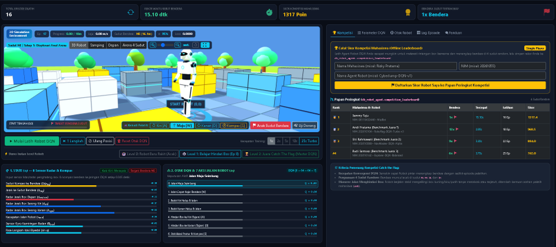

# 🤖🚩 RoboFlag AI — Simulasi Kompetisi RL Robot Catch the Flag (DQN)


-4479A1?logo=mysql&logoColor=white)

-FF6F00?logo=tensorflow&logoColor=white)


**RoboFlag AI** adalah laboratorium dan platform **Kompetisi Offline Mahasiswa (Single-Player)** berbasis **Reinforcement Learning (RL)** menggunakan algoritma **Deep Q-Network (DQN)**. Mahasiswa dapat mengunduh (*clone/download*) repositori ini dari GitHub, melatih dan mengarahkan **Agent Robot Humanoid 3D** secepat mungkin untuk berjalan melewati rintangan **box berwarna (manuver menghindar)** dan menangkap **Bendera Merah** yang muncul secara **random di 4 sudut arena** (`NE`, `NW`, `SE`, `SW`). Seluruh sistem berjalan murni di browser menggunakan **PHP 8+, MySQL (`db_robot_agent`), Three.js, TensorFlow.js, dan Web Workers** (tanpa Python dan tanpa Node.js).

---

## 📸 Preview Lingkungan Simulasi 3D



---

## 🏆 Aturan & Prosedur Kompetisi Mahasiswa (Offline Single-Player)

1. **Unduh Repositori dari GitHub**: Setiap mahasiswa menjalankan simulasi secara lokal di komputer masing-masing (XAMPP).
2. **Misi Utama (Catch the Flag di 4 Sudut Random)**:
   - Setiap episode dimulai dengan **Agent Robot 3D** berjalan dari titik tengah arena `(0, 0)`.
   - **Bendera Merah** akan muncul secara **acak (random)** di salah satu dari 4 titik sudut arena:
     - **Sudut Timur Laut (`NE`)**
     - **Sudut Barat Laut (`NW`)**
     - **Sudut Tenggara (`SE`)**
     - **Sudut Barat Daya (`SW`)**
3. **Rintangan Box Berwarna & Kemudi Pelatih Mahasiswa (*Human-in-the-Loop Coaching*)**:
   - Di sepanjang jalur menuju sudut bendera terdapat **box berwarna** (kardus kuning, blok biru, kubus putih, dan dinding abu-abu berlampu cyan).
   - Robot berjalan biasa (tidak melompat) dan belajar membaca radar depan/kiri/kanan untuk berbelok menghindari box.
   - **Mahasiswa Bisa Mengarahkan Robot Secara Langsung**: Saat sesi latihan berjalan, mahasiswa dapat menekan tombol **`W` (Jalan Cepat Maju)**, **`A` (Belok Kiri Hindari Box)**, **`D` (Belok Kanan Hindari Box)**, atau **`S` (Stabilkan Kompas)** — atau klik tombol **`🎮 Kemudi Pelatih`** di layar. Setiap arahan mahasiswa dimasukkan **3x lipat ke dalam Memori Experience Replay DQN**, sehingga jaringan saraf robot langsung meniru manuver mahasiswa!
4. **Kriteria Pemenang**:
   - Mahasiswa yang mampu melatih Agent AI paling cepat (jumlah episode sedikit), konsisten merebut bendera di ke-4 sudut random dengan waktu tercepat, dan mencetak **Skor Kompetisi tertinggi** di tabel `db_robot_agent.competition_leaderboard` adalah pemenangnya!

---

## 🧠 Arsitektur Reinforcement Learning (Deep Q-Network / DQN)

1. **📡 State / 8 Sensor Radar & Kompas Robot ($s_t \in [-1, 1]^8$)**:
   - `s0`: **Sudut Kompas ke Bendera ($\Delta\psi_{\text{flag}}$)** — selisih arah hadap robot terhadap sudut bendera aktif.
   - `s1`: **Jarak ke Sudut Bendera ($d_{\text{flag}}$)** — jarak Euclidean robot menuju bendera.
   - `s2`: **Radar Jarak Box Depan ($d_{\text{box,front}}$)** — mendeteksi keberadaan box penghalang tepat di depan robot.
   - `s3`: **Radar Jarak Box Serong Kiri ($d_{\text{left}}$)** — mendeteksi ruang kosong di sebelah kiri depan.
   - `s4`: **Radar Jarak Box Serong Kanan ($d_{\text{right}}$)** — mendeteksi ruang kosong di sebelah kanan depan.
   - `s5`: **Kecepatan Jalan Robot ($v_{\text{walk}}$)** — kecepatan langkah jalan robot.
   - `s6`: **Sensor Gyro Kemiringan Badan ($\theta_{\text{torso}}$)** — menjaga stabilitas postur robot saat berbelok.
   - `s7`: **Fase Langkah Kaki Bipedal ($\sin\phi$)** — sinkronisasi ayunan langkah kaki kiri dan kanan.

2. **⚡ Action Space / 7 Aksi Jalan & Manuver Robot ($a_t \in \{0..6\}$)**:
   - `0`: **Jalan Maju Seimbang**
   - `1`: **Jalan Cepat Kejar Bendera `[W]`**
   - `2`: **Belok Kiri Halus & Jalan**
   - `3`: **Belok Kanan Halus & Jalan**
   - `4`: **Hindari Box ke Kiri (Tajam) `[A]`**
   - `5`: **Hindari Box ke Kanan (Tajam) `[D]`**
   - `6`: **Stabilisasi Postur & Kompas `[S]`**

3. **🎯 Fungsi Reward ($r_t$)**:
   $$r_t = R_{\text{kejar\_bendera}} + R_{\text{kompas\_gyro}} + R_{\text{hindari\_box}} - P_{\text{energi}} + R_{\text{terminal}}$$

---

## 🗄️ Struktur Database (`db_robot_agent`)

Skema database tersedia di [`database/db_robot_agent.sql`](database/db_robot_agent.sql) dan **otomatis dibuat serta diisi (*auto-seed*)** saat aplikasi pertama kali dibuka:
- **`reward_presets`**: 4 preset strategi hyperparameter DQN & bobot reward kompetisi.
- **`training_sessions`**: Rekapitulasi sesi latihan mahasiswa.
- **`episode_logs`**: Log real-time setiap episode beserta sudut bendera (`NE/NW/SE/SW`) dan jumlah lompatan box.
- **`saved_models`**: Penyimpanan tensor bobot jaringan saraf TensorFlow.js (`weights_json`).
- **`competition_leaderboard`**: Papan peringkat offline kompetisi mahasiswa (Nama, NIM, Nama Model, Bendera Tertangkap, Waktu Tercepat, & Skor Kompetisi).

---

## 🚀 Cara Menjalankan di Lokal (XAMPP)

1. Simpan folder proyek di dalam `htdocs` XAMPP:
   ```text
   c:\xampp\htdocs\REINFORCEMENTLEARNING\simulasi-rl-robot-catch-flag-competitions
   ```
2. Pastikan modul **Apache** dan **MySQL** di XAMPP Control Panel berstatus **Running**.
3. Buka browser dan akses:
   ```text
   http://localhost/REINFORCEMENTLEARNING/simulasi-rl-robot-catch-flag-competitions/
   ```
   *(Database `db_robot_agent` beserta seluruh tabel dan data awalnya akan diinisialisasi secara otomatis).*
